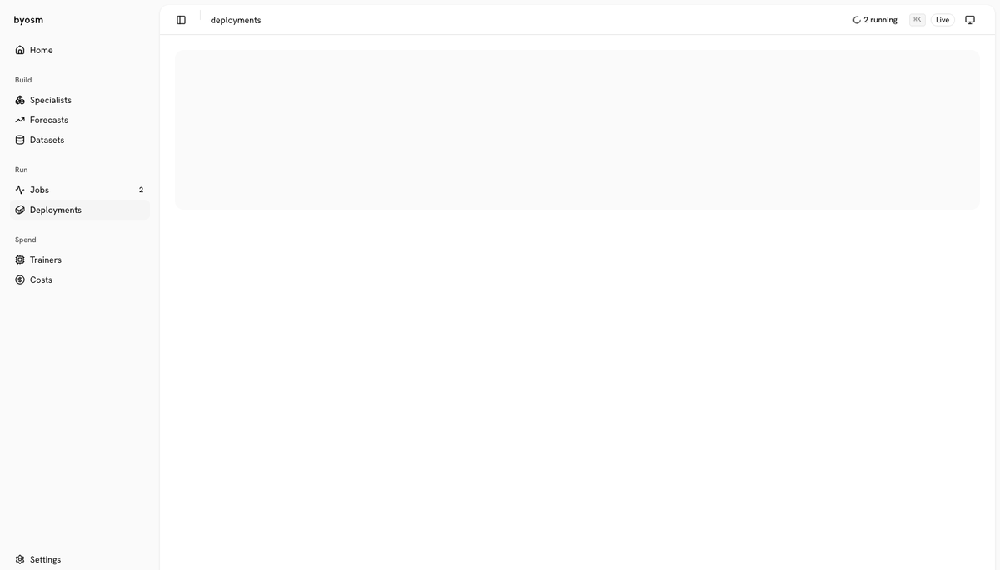
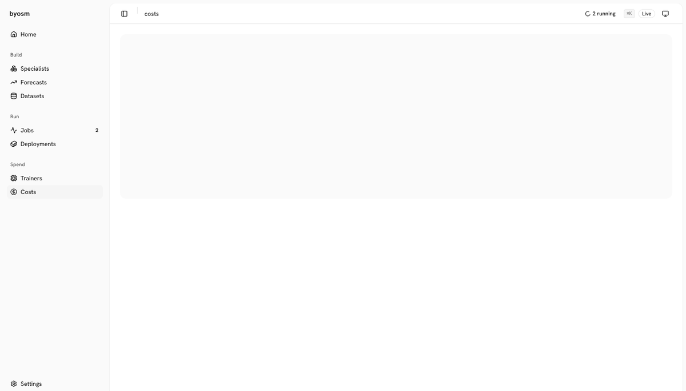

<p align="center"><b>Tour</b> · <a href="docs/assumptions.md">Goal and bet</a> · <a href="docs/methodology.md">Methodology</a> · <a href="docs/results.md">Results</a> · <a href="docs/details.md">Details</a></p>

<h1 align="center">BYOSM</h1>

<p align="center">
  <b>Build Your Own Specialist Model.</b><br>
  One sentence in, a small model for that one job, scored against LLMs, Jev and fine-tuned models on public benchmarks, on any CPU.
  <br><br>
  <a href="#run-it"><strong>Run it »</strong></a>
  &nbsp;·&nbsp;
  <a href="docs/results.md"><strong>Results »</strong></a>
  &nbsp;·&nbsp;
  <a href="https://huggingface.co/bsye"><strong>Models on Hugging Face »</strong></a>
</p>

<p align="center">
  <a href="https://www.anthropic.com/claude-code"></a>
  <a href="https://openai.com/codex"></a>
  <a href="https://ollama.com"></a>
  <a href="https://huggingface.co"></a>
  <a href="https://onnx.ai"></a>
  <a href="https://www.docker.com"></a>
  <a href="https://www.postgresql.org"></a>
</p>

<p align="center"></p>

## Run it

```bash
git clone https://github.com/bsye/BYOSM && cd BYOSM
python3.11 -m venv .venv && .venv/bin/pip install -e '.[dev,silero]'
.venv/bin/byosm app                     # opens http://127.0.0.1:8765
```

State lives in one database: SQLite by default, Postgres with `DATABASE_URL` (`pip install -e '.[postgres]'`).

## Tour

| Step | What you do |
|---|---|
| [1. Describe the task](#1-describe-the-task) | One sentence, and the LLM you have |
| [2. Watch it build](#2-watch-it-build) | Follow each job live |
| [3. Check its health](#3-check-its-health) | See what fails and what to try next |
| [4. Compare with rivals](#4-compare-with-rivals) | Every model on the same splits |
| [5. Test it on new inputs](#5-test-it-on-new-inputs) | Your test sets and Hugging Face rivals |
| [6. Act while the user types](#6-act-while-the-user-types) | A team fires before the sentence ends |
| [7. Choose the LLMs](#7-choose-the-llms) | What each task uses and costs |
| [8. Ship it](#8-ship-it) | Python, HTTP, Docker or Hugging Face |
| [9. Run it in a container](#9-run-it-in-a-container) | Each model or team isolated, live |
| [10. Know what it costs](#10-know-what-it-costs) | Build cost against an LLM, and when it pays off |

### 1. Describe the task

One sentence and the LLM you have; the autopilot does the rest. Home shows every model's health, its next action and what this machine can train.


### 2. Watch it build

Every job live: its stages, the LLM calls behind each, progress and the log.


### 3. Check its health

A health score with every check behind it, and the next step for each failing check, such as a lower learning rate when it overfits.


### 4. Compare with rivals

Test and calib scores with 95% intervals for every experiment and rival, scored by the same code.


### 5. Test it on new inputs

Hugging Face models for the same task, ready to add as rivals, and test sets with every model's score.


### 6. Act while the user types

A team of specialists picks the action and its arguments while the sentence is still being typed.


### 7. Choose the LLMs

Tokens and calls per task and model, and the model and effort each task uses.


### 8. Ship it

One ONNX bundle to call from Python, the command line, HTTP or a Docker image.


### 9. Run it in a container

Deploy a specialist or a team into its own read-only container with CPU and memory limits, watch it live and send it inputs.



### 10. Know what it costs

What each model cost to build, the LLM's cost per item measured on its rival runs, and after how many items the fine-tune pays off.



Models on Hugging Face: [bsye](https://huggingface.co/bsye) ·
[byosm-doctype](https://huggingface.co/bsye/byosm-doctype) ·
[byosm-intent](https://huggingface.co/bsye/byosm-intent) ·
[byosm-vad](https://huggingface.co/bsye/byosm-vad)

<p align="center"><b>Tour</b> · <a href="docs/assumptions.md">Goal and bet</a> · <a href="docs/methodology.md">Methodology</a> · <a href="docs/results.md">Results</a> · <a href="docs/details.md">Details</a></p>
