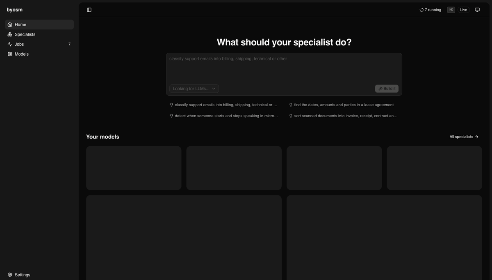
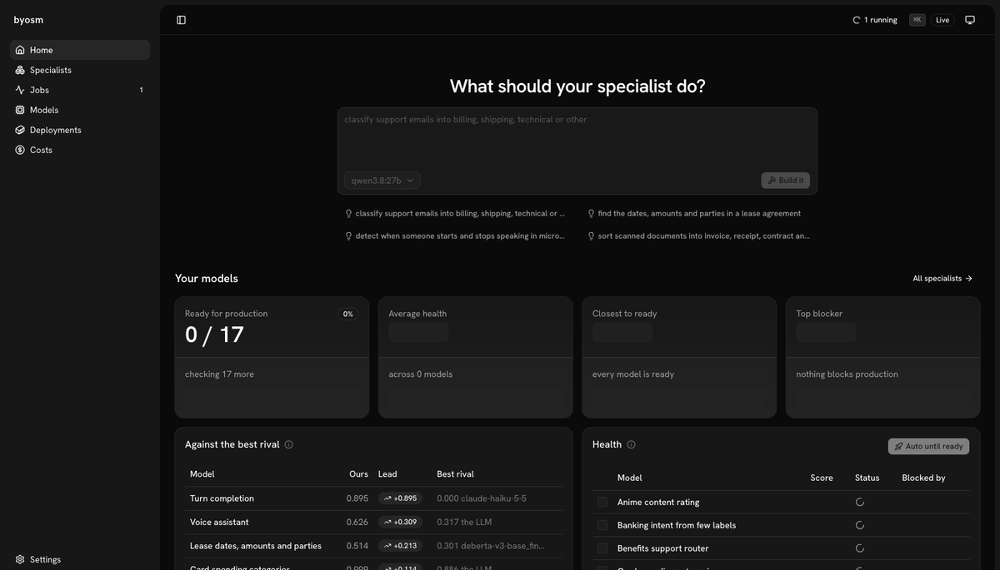
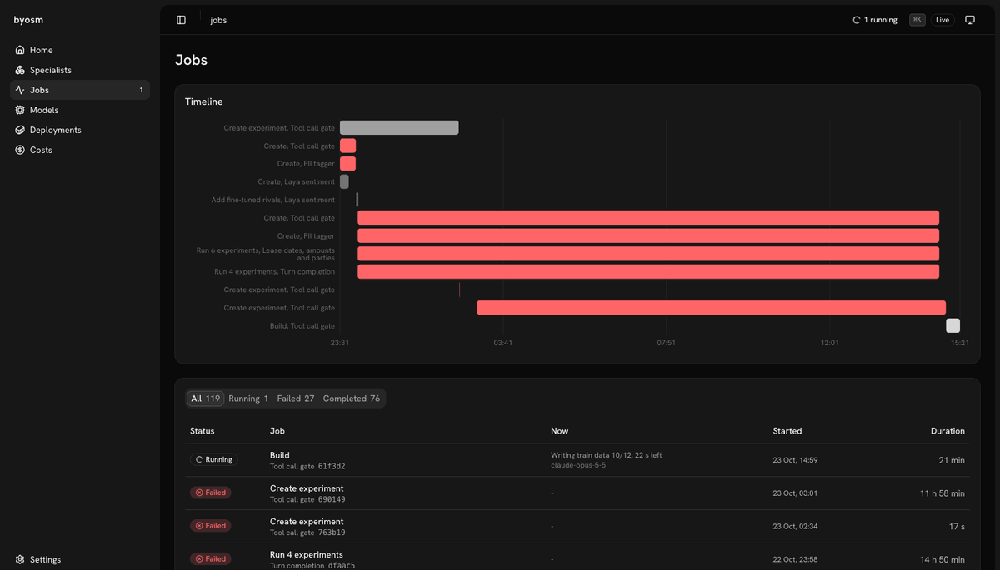
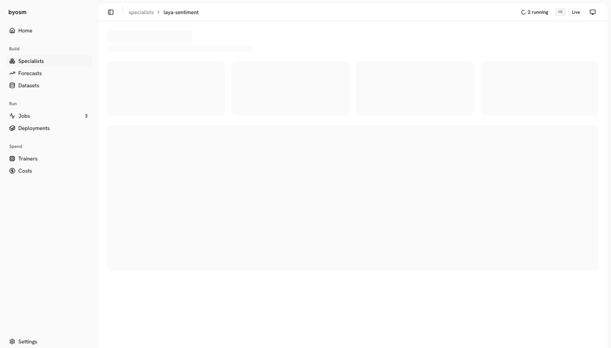
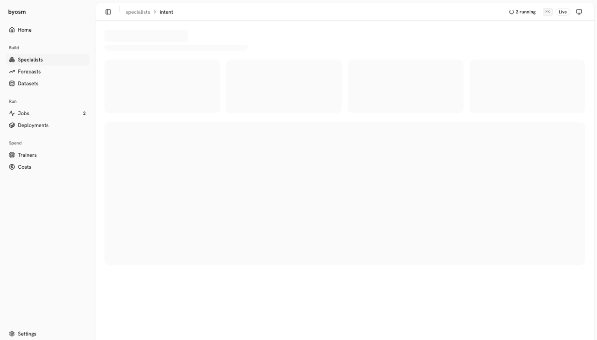
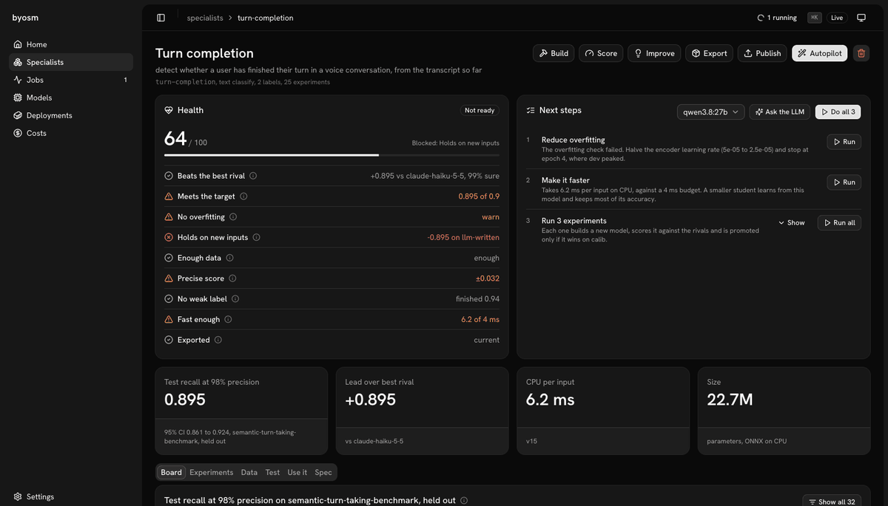
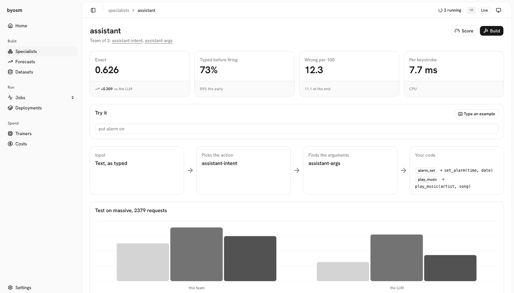
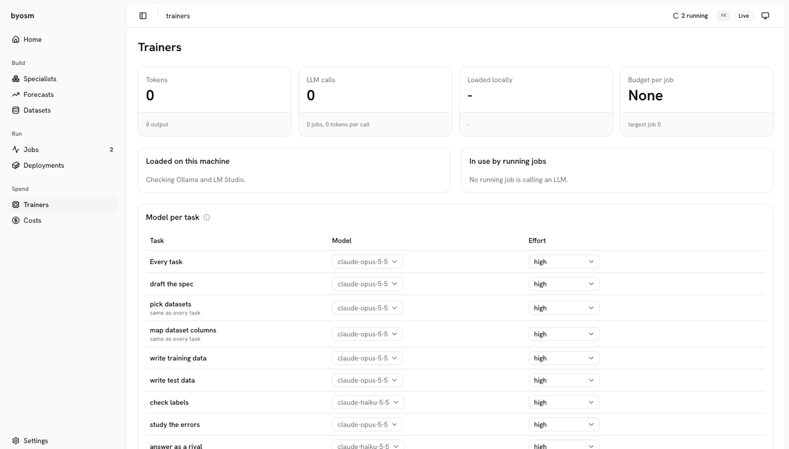
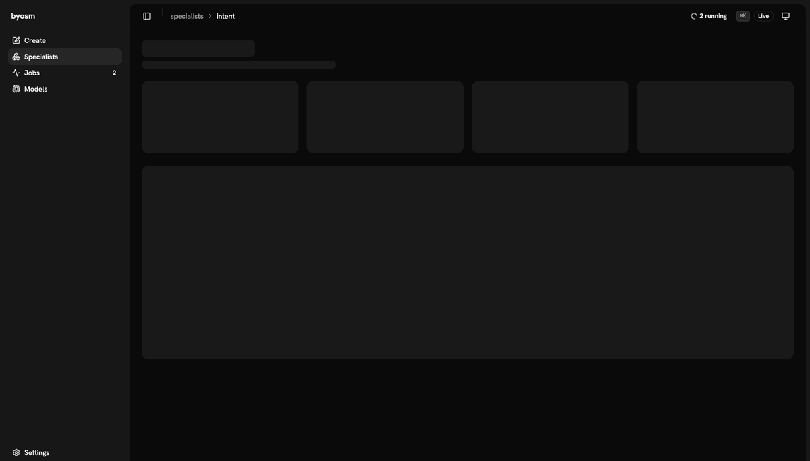

<p align="center"><b>Tour</b> · <a href="docs/assumptions.md">Goal and bet</a> · <a href="docs/methodology.md">Methodology</a> · <a href="docs/results.md">Results</a> · <a href="docs/details.md">Details</a></p>

<h1 align="center">BYOSM</h1>

<p align="center">
  <b>Build Your Own Specialist Model.</b><br>
  One sentence in, a small model for that one job, scored against LLMs, Jev and fine-tuned models on public benchmarks, on any CPU.
  <br><br>
  <a href="#run-it"><strong>Run it »</strong></a>
  &nbsp;·&nbsp;
  <a href="docs/results.md"><strong>Results »</strong></a>
  &nbsp;·&nbsp;
  <a href="https://huggingface.co/bsye"><strong>Models on Hugging Face »</strong></a>
</p>

<p align="center">
  <a href="https://www.anthropic.com/claude-code"></a>
  <a href="https://openai.com/codex"></a>
  <a href="https://ollama.com"></a>
  <a href="https://huggingface.co"></a>
  <a href="https://onnx.ai"></a>
  <a href="https://www.docker.com"></a>
  <a href="https://www.postgresql.org"></a>
</p>

<p align="center">
  <a href="LICENSE"></a>
  
  
</p>

<p align="center"></p>

## Features

| Build | Evaluate | Observe | Ship |
|---|---|---|---|
| ✅ Claude Code or Codex | ✅ Same scorer for all rivals | ✅ Every job live | ✅ int8 ONNX on any CPU |
| ✅ Ollama, LM Studio, API keys | ✅ No leaks between splits | ✅ LLM decisions as a tree | ✅ HTTP server and Docker |
| ✅ Hugging Face datasets | ✅ Overfitting check | ✅ Tokens per task and model | ✅ Publish to Hugging Face |
| ✅ LLM data, judge-checked | ✅ Health score | ✅ Test sets, Excel export | ✅ Teams that act as you type |
| ✅ Experiments and autopilot | ✅ Hugging Face rivals | ✅ Paged tables, live counts | ✅ SQLite or Postgres |

## What's new, and what isn't

The recipe is not new: fine-tune a small pretrained encoder on labelled examples. BYOSM automates everything around it
from one sentence. It finds a public benchmark and training data on Hugging Face, or has an LLM write the data and a
second LLM check the labels. It trains, proposes and runs experiments, and scores the result against the models you
would otherwise use, with the same code and a paired bootstrap:

- **LLMs** called zero-shot (Claude, GPT, Qwen through Ollama, ...).
- **[Jev](https://typesafe.ai)**, TypeSafe's judgment model: a fast hosted classifier that takes label definitions instead of training.
- **Models already fine-tuned on the same benchmark**, found on Hugging Face by a web-searching LLM. These are the fairest bar.

Close relatives: [SetFit](https://github.com/huggingface/setfit) (few-shot fine-tuning of sentence encoders) and
[AutoTrain](https://huggingface.co/autotrain) (no-code fine-tuning on your data). BYOSM starts from a sentence instead
of a dataset, and its output is a comparison you can trust as much as the model.

## Run it

```bash
git clone https://github.com/bsye/BYOSM && cd BYOSM
python3.11 -m venv .venv && .venv/bin/pip install -e '.[dev,silero]'
.venv/bin/byosm app                     # opens http://127.0.0.1:8765 with its token
```

State lives in one database: SQLite by default, Postgres with `DATABASE_URL` (`pip install -e '.[postgres]'`).

## Tour

| Step | What you do |
|---|---|
| [1. Describe the task](#1-describe-the-task) | One sentence, and the LLM you have |
| [2. Watch it build](#2-watch-it-build) | Follow each job live |
| [3. Check its health](#3-check-its-health) | See what fails and what to try next |
| [4. Compare with rivals](#4-compare-with-rivals) | Every model on the same splits |
| [5. Test it on new inputs](#5-test-it-on-new-inputs) | Your test sets and Hugging Face rivals |
| [6. Act while the user types](#6-act-while-the-user-types) | A team fires before the sentence ends |
| [7. Choose the LLMs](#7-choose-the-llms) | What each task uses and costs |
| [8. Ship it](#8-ship-it) | Python, HTTP, Docker or Hugging Face |

### 1. Describe the task

One sentence and the LLM you have; the autopilot does the rest.



### 2. Watch it build

Every job live: its stages, the LLM calls behind each, progress and the log.



### 3. Check its health

A health score with every check behind it, and the experiments the LLM proposes to fix what fails.



### 4. Compare with rivals

Test and calib scores with 95% intervals for every experiment and rival, scored by the same code.



### 5. Test it on new inputs

Hugging Face models for the same task, ready to add as rivals, and test sets with every model's score.



### 6. Act while the user types

A team of specialists picks the action and its arguments while the sentence is still being typed.



### 7. Choose the LLMs

Tokens and calls per task and model, and the model and effort each task uses.



### 8. Ship it

One ONNX bundle to call from Python, the command line, HTTP or a Docker image.



Models on Hugging Face: [bsye](https://huggingface.co/bsye) ·
[byosm-doctype](https://huggingface.co/bsye/byosm-doctype) ·
[byosm-intent](https://huggingface.co/bsye/byosm-intent) ·
[byosm-vad](https://huggingface.co/bsye/byosm-vad)

## Limitations

Where it does not win, from the [results](docs/results.md):

| Case | What happened |
|---|---|
| Banking77, first model | 0.797 against Jev's 0.807; it took several rounds of experiments to reach 0.937 |
| Banking77 against the best public fine-tune | 0.937 against 0.937 for `DarioFrK/sift-banking77-modernbert` (about 6× larger): a tie (P(better) 0.54) |
| Named entities (CoNLL-2003) | 0.913 against 0.910 for `bert-base-NER`: a tie (P(better) 0.86) |
| Card spend, insurance intents | Scored on held-out splits of their own data, not public benchmarks |
| Insurance intents on LLM-written inputs | 0.410 against Jev's 0.885: it does not yet hold on new inputs |
| Turn detection | The LLM has the higher accuracy (0.952 against 0.944); BYOSM wins only at 98% precision |
| Languages | Every specialist so far is English only |

## Why the numbers hold up

A small model "beating GPT" is easy to fake. Each of these guards runs in code on every specialist; none is a promise in prose.

| Risk | Guard |
|---|---|
| Grading on your own homework | Rivals (LLMs, Hugging Face models, LiveKit, Silero) go through the same scorer, on the same frozen splits, with thresholds calibrated on the same calib split. |
| Picking the lucky run | Promotion and the autopilot decide on calib only. Test is reported once, with a 95% bootstrap interval. |
| A lead that is noise | Every "ours vs theirs" is a paired bootstrap over the same rows; the health check counts a lead only when 95% of resamples keep it. |
| Memorising the training data | The overfitting check compares train, dev, calib and test, flags a dev curve that peaks and falls, and flags calib over-use. |
| Test rows leaking into training | Near-duplicate rows are grouped before splitting, so paraphrases never straddle train and test; the overfitting check also measures train/test overlap and the score without it. |
| Tiny test sets | Health fails "Precise score" below 100 test rows; a build adopts a bigger held-out set when an experiment brings one. |
| Only good on its own kind of data | "Holds on new inputs" scores it on test sets written separately; a model is not production ready until that is measured. |
| A metric that hides the trade-off | Constrained metrics carry their bound ("recall at 98% precision"), and a rival that never reaches the bound shows what it does reach. |
| Numbers typed by hand | The result tables are regenerated from the results database by `byosm report`; model cards separate what code measured from what an LLM wrote. |

Rules and benchmarks: [Methodology](docs/methodology.md). Every number: [Results](docs/results.md).

<p align="center"><b>Tour</b> · <a href="docs/assumptions.md">Goal and bet</a> · <a href="docs/methodology.md">Methodology</a> · <a href="docs/results.md">Results</a> · <a href="docs/details.md">Details</a></p>
