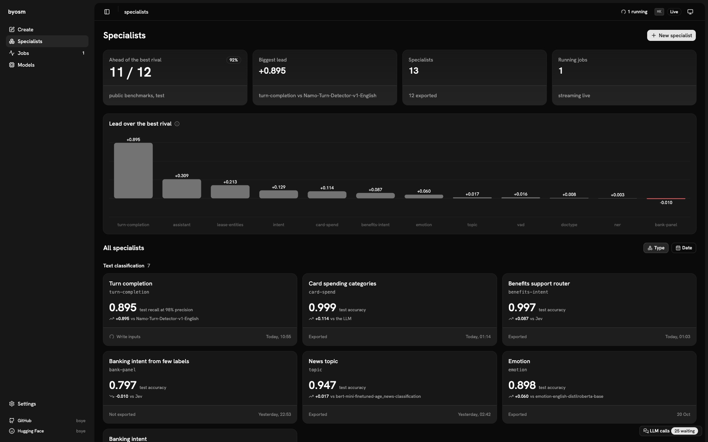
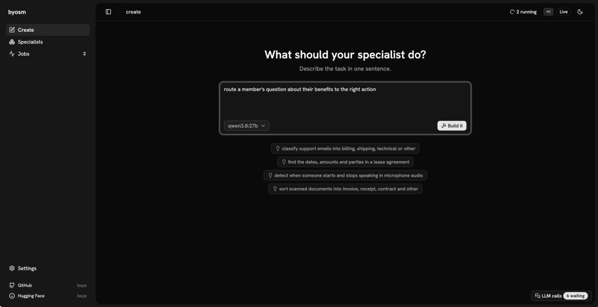
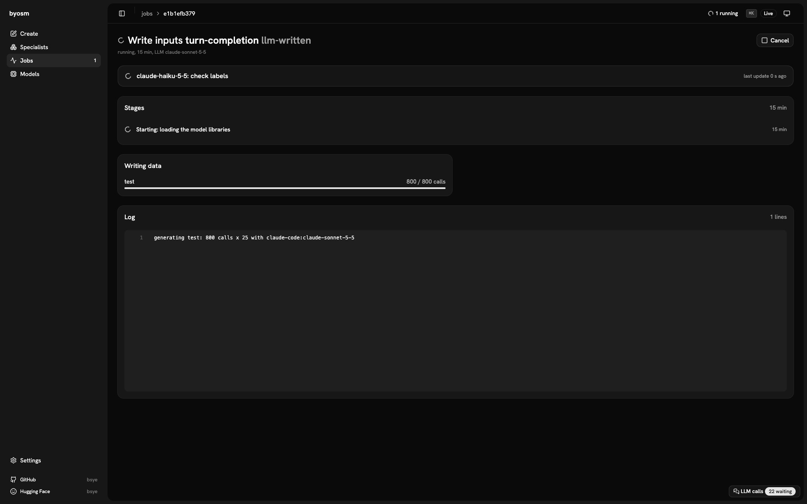
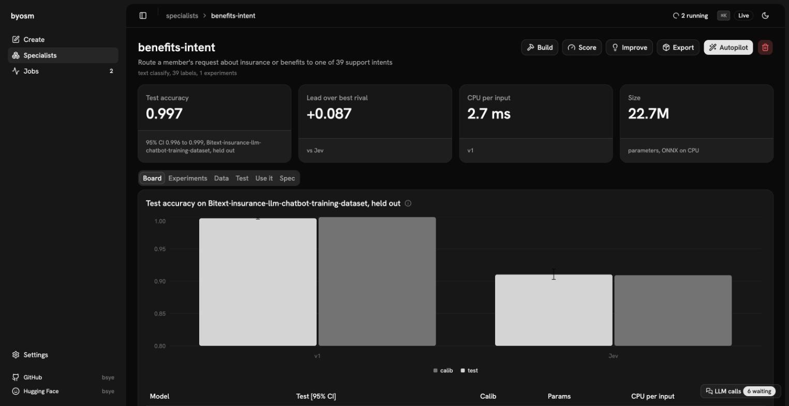
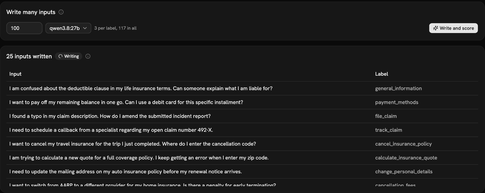
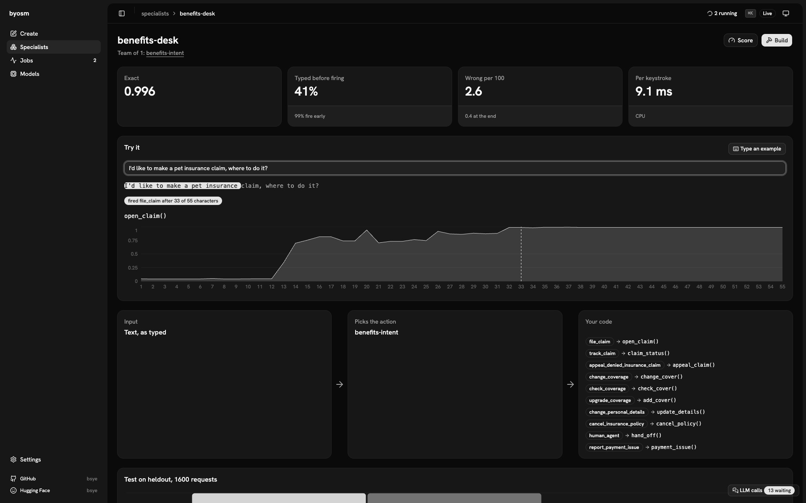

<h1 align="center">BYOSM</h1>

<p align="center"><b>Build Your Own Specialist Model.</b><br>One sentence in, a small model out that beats the big ones at its job, on a public benchmark, on any CPU.</p>

<p align="center">
  <a href="LICENSE"></a>
  <a href="https://huggingface.co/bsye"></a>
  
  
</p>

<p align="center"></p>

<p align="center">
  <a href="#run-it">Run it</a> ·
  <a href="#tour">Tour</a> ·
  <a href="#results">Results</a> ·
  <a href="#how-it-works">How it works</a> ·
  <a href="#quickstart">Command line</a>
</p>

## Run it

```bash
git clone https://github.com/bsye/BYOSM && cd BYOSM
python3.11 -m venv .venv && .venv/bin/pip install -e '.[dev,silero]'
.venv/bin/byosm app                     # opens http://127.0.0.1:8765 with its token
```

Self-host with Docker: `BYOSM_APP_TOKEN=<long random string> docker compose -f docker/compose.yaml up`.
It brings its own LLM picker: local Ollama or LM Studio, Claude Code, Codex, or an API key.

## Tour

### Describe the task

One sentence and the LLM you have. The autopilot writes the spec, finds the benchmark and the rivals, and trains until
it wins or the budget ends.



### Watch it build

Every job live: its step, its progress and every call it makes to the LLM, even with several jobs running.



### See it against its rivals

Test score with its 95% interval, the lead over the best rival, CPU time per input and size, with an overfitting check
under the board.



### Test it on new inputs

An LLM writes as many labelled inputs as you ask for, each one shown as it arrives, and every model is scored on them.



### Act while the user types

A team of specialists wired to your functions fires the action before the sentence is finished, with no LLM at
runtime.



Models on Hugging Face: [bsye](https://huggingface.co/bsye) ·
[byosm-doctype](https://huggingface.co/bsye/byosm-doctype) ·
[byosm-intent](https://huggingface.co/bsye/byosm-intent) ·
[byosm-vad](https://huggingface.co/bsye/byosm-vad)

## Goal

Describe a task in one sentence. Get back a small model that does that one job better than general models, LLMs
included, proven on a public benchmark, and fast enough to run on any CPU.

```bash
byosm "classify the emotion of a short English text: joy, love, sadness, anger, fear or surprise"
```

That one command names the task, works out what kind of model it needs (text, audio, image or document; one label
per input or one per word or frame), writes the spec, finds the benchmark and the models to beat, trains, keeps going until it wins or
runs out of time, and exports an ONNX bundle.

## The bet

| | we bet that | where it stands |
|---|---|---|
| 1 | A small model trained for one job beats a general model at that job, LLMs included. | **Holds on every public benchmark so far.** Ahead of the best outside model on test everywhere (on names, only just), and far ahead of Qwen 3.8 27B on every task an LLM can do. On documents, DiT-base still edges us on calib. |
| 2 | We can stay honest: choose on calib, report test once, compare with a paired bootstrap. | **Built in** to promotion, the autopilot and export. Broken once by hand: the training-recipe default was picked on test (below). |
| 3 | Specialists are cheap: they run side by side on a laptop CPU, no GPU, no PyTorch. | **Yes.** Size and CPU time are in every table. |
| 4 | A team of small specialists does a whole task without an LLM, and does it better than the LLM alone. | **Holds on MASSIVE**, the first system: a router and a tagger against Qwen doing the whole task. Streaming while you type is next. |

Still open:

- **Specialists vs one shared generalist** (`byosm bench`). Not run yet: it grades on a split the promoted models
  trained on, so it has to move to the public benchmarks first.
- **The autopilot on its own.** Two full runs from one sentence: emotion won inside its budget; topic needed two more
  data steps by hand. VAD, documents and intent were built step by step.

## Results

Every table below is generated from the results database by `byosm report`, never typed by hand.
`byosm report --check` fails the tests if one is stale.

Rivals: `llm` is Qwen 3.8 27B, local and zero-shot. `jev` is TypeSafe's Jev judgment model, zero-shot over the same
label definitions, one API request per item; its time column is the API round trip, not local CPU. `hf:` rivals are
public fine-tuned checkpoints.

<!-- report:summary -->
| task | benchmark (metric) | our model | our test score [95% CI] | best outside baseline (on calib) | its test score | ours minus baseline on test (paired bootstrap) | calib, the selection split: ours vs baseline |
|---|---|---|---|---|---|---|---|
| Which words of a request fill an action's arguments, and their type (MASSIVE slots) | AmazonScience/massive (span_f1) | v2 (70.73M) | 0.734 [0.717, 0.751] | no outside baseline scored yet | - | - | - |
| Which of the assistant's 60 actions a request asks for (MASSIVE intents) | AmazonScience/massive (accuracy) | stream (22.74M) | 0.890 [0.877, 0.901] | jev (-) | 0.815 [0.799, 0.831] | +0.075, P(better) = 1.00 | 0.894 vs 0.824 (ahead) |
| 77-way banking intent classification | mteb/banking77 (accuracy) | v1 (22.74M) | 0.797 [0.780, 0.812] | jev (-) | 0.807 [0.792, 0.822] | -0.010, P(better) = 0.09 | 0.747 vs 0.776 (behind) |
| Route a member's request about insurance or benefits to one of 39 support intents | benefits-intent-builtin (accuracy) | v1 (22.73M) | 0.997 [0.996, 0.999] | jev (-) | 0.910 [0.903, 0.919] | +0.087, P(better) = 1.00 | 0.999 vs 0.909 (ahead) |
| Categorise a card or bank transaction description into one of 17 spending categories | card-spend-builtin (accuracy) | v1 (22.72M) | 0.999 [0.999, 1.000] | llm (-) | 0.886 [0.877, 0.894] | +0.114, P(better) = 1.00 | 0.998 vs 0.877 (ahead) |
| 16-way document type classification (RVL-CDIP classes) | chainyo/rvl-cdip (accuracy) | v2-ditft (109.55M) | 0.948 [0.941, 0.956] | hf:microsoft/dit-base-finetuned-rvlcdip (85.82M) | 0.940 [0.932, 0.948] | +0.008, P(better) = 1.00 | 0.935 vs 0.936 (behind) |
| Classify the primary emotion expressed in a short English text (single sentence, tweet-style or short social media string) into one of six named emotions (sadness, joy, love, anger, fear, surprise). Any text that does not clearly express one of these dominates falls into a catch-all neutral-other class (including neutral statements, irony/sarcasm without a dominant named emotion, ambiguity, or non-English). | dair-ai/emotion (accuracy) | v1 (22.72M) | 0.898 [0.883, 0.913] | hf:j-hartmann/emotion-english-distilroberta-base (82.12M) | 0.838 [0.819, 0.856] | +0.060, P(better) = 1.00 | 0.904 vs 0.813 (ahead) |
| 77-way banking intent classification | mteb/banking77 (accuracy) | final-s1 (22.74M) | 0.937 [0.928, 0.948] | jev (-) | 0.808 [0.792, 0.822] | +0.129, P(better) = 1.00 | 0.948 vs 0.784 (ahead) |
| Token-tag every token in a lease-agreement text to identify spans of DATE, AMOUNT, and PARTY (landlord, tenant, guarantor, or other named signatory) using BIO tagging. | lease-entities-builtin (span_f1) | v1 (70.69M) | 0.514 [0.389, 0.651] | hf:Isotonic/deberta-v3-base_finetuned_ai4privacy_v2 (183.92M) | 0.301 [0.178, 0.432] | +0.213, P(better) = 1.00 | 0.632 vs 0.370 (ahead) |
| Named entity recognition (CoNLL-2003 tags) | BramVanroy/conll2003 (span_f1) | v3 (70.69M) | 0.913 [0.903, 0.921] | hf:dslim/bert-base-NER (107.73M) | 0.910 [0.900, 0.918] | +0.003, P(better) = 0.86 | 0.928 vs 0.925 (ahead) |
| Classify an English news-headline+summary pair into one of four topics: world, sports, business, science/technology, with an explicit 'other' catch-all for items that fit none of the four. | fancyzhx/ag_news (accuracy) | v3 (22.72M) | 0.947 [0.937, 0.955] | hf:mrm8488/bert-mini-finetuned-age_news-classification (11.17M) | 0.930 [0.919, 0.939] | +0.017, P(better) = 1.00 | 0.955 vs 0.934 (ahead) |
| From the incremental transcript of a speaker's current turn (text so far, may end mid-word), decide whether the speaker has finished their conversational turn (finished = true) or is still speaking / likely to say more (finished = false). The model is called repeatedly as tokens arrive; this spec is a single binary classification of a partial-utterance. | turn-completion-builtin (recall_at_precision) | v15 (22.71M) | 0.895 [0.861, 0.924] | livekit-turn (-) | 0.000 [0.000, 0.636] | +0.895, P(better) = 1.00 | 0.753 vs 0.000 (ahead) |
| Per-10ms-frame speech vs non-speech on 16kHz mic audio | nccratliri/vad-human-ava-speech (f1) | v3 (0.10M) | 0.882 [0.863, 0.899] | silero (0.55M) | 0.865 [0.839, 0.887] | +0.016, P(better) = 1.00 | 0.814 vs 0.772 (ahead) |
<!-- /report:summary -->

### Voice activity ([bsye/byosm-vad](https://huggingface.co/bsye/byosm-vad))

<!-- report:vad -->
| model | built from | train rows | params | CPU | test f1 [95% CI] | calib f1 |
|---|---|---|---|---|---|---|
| **v3** (promoted) | v2 + `train.ema=true train.holdout_test=auto` | 8400 | 0.10M | 0.169/30ms | 0.882 [0.863, 0.899] | 0.814 |
| v2 | v1 + real-data-ava, utterance-labels | 8400 | 0.10M | 0.176/30ms | 0.876 [0.855, 0.895] | 0.803 |
| silero | outside baseline | - | 0.55M | 0.066/32ms | 0.865 [0.839, 0.887] | 0.772 |
| v1 | no recorded parent | 3000 | 0.10M | 0.170/30ms | 0.848 [0.818, 0.873] | 0.811 |
| v0 | no recorded parent | 3000 | 0.10M | 0.169/30ms | 0.845 [0.815, 0.868] | 0.802 |
| energy | outside baseline | - | - | - | 0.731 [0.674, 0.776] | 0.733 |

Suite `ava` (nccratliri/vad-human-ava-speech): 20 test and 8 calib recordings. Selection uses calib; test is only reported. Every scored experiment is listed. CPU is PyTorch time per input, or per streaming chunk, timed when the row was last scored, so rows scored in different sessions are not a controlled speed comparison.
<!-- /report:vad -->

- Trained on the train part of AVA-Speech (film and TV audio), kept apart from the test files. Silero never saw that
  domain: a win where the thesis says it should be.
- v2 came straight from `byosm improve`: use real film audio, label whole utterances.
- v3 changed more than its one recorded edit, so its gain over v2 can't be pinned on EMA alone.
- Few recordings in the suite: trust the paired bootstrap, not overlapping CIs.

### Documents ([bsye/byosm-doctype](https://huggingface.co/bsye/byosm-doctype))

<!-- report:doctype -->
| model | built from | train rows | params | CPU | test accuracy [95% CI] | calib accuracy |
|---|---|---|---|---|---|---|
| **v2-ditft** (promoted) | v1 + `document.image_backbone=hf:microsoft/dit-base-finetuned-rvlcdip document.image_pool=pooler` | 34935 (+5823 builtin test) | 109.55M | 43.27ms | 0.948 [0.941, 0.956] | 0.935 |
| hf:microsoft/dit-base-finetuned-rvlcdip | outside baseline | - | 85.82M | 36.76ms | 0.940 [0.932, 0.948] | 0.936 |
| v1 | r2 + more-data | 34935 (+5823 builtin test) | 109.55M | 44.65ms | 0.918 [0.908, 0.928] | 0.930 |
| r2 | fused-dit + `train.holdout_test=auto` | 11520 (+1920 builtin test) | 109.55M | 48.11ms | 0.905 [0.894, 0.915] | 0.906 |
| fused-dit | fused + more-data, domain-encoder, train-longer | 9600 | 109.55M | 46.90ms | 0.884 [0.873, 0.895] | 0.904 |
| distill-r2 | r2 + distill | 11520 (+1920 builtin test) | 17.58M | 10.68ms | 0.882 [0.870, 0.893] | 0.894 |
| fused | spec.yaml + `document.route=fused` | 2400 | 45.70M | 24.39ms | 0.801 [0.787, 0.815] | 0.804 |
| llm | outside baseline | - | - | - | 0.744 [0.729, 0.759] | 0.744 |
| text | spec.yaml + `document.route=text` | 2400 | 23.41M | 6.74ms | 0.741 [0.725, 0.756] | 0.728 |
| visual | spec.yaml + `document.route=visual` | 2400 | 22.75M | 18.83ms | 0.645 [0.628, 0.662] | 0.654 |

Suite `rvl` (chainyo/rvl-cdip): 3200 test and 800 calib items. Selection uses calib; test is only reported. Every scored experiment is listed. CPU is PyTorch time per input, or per streaming chunk, timed when the row was last scored, so rows scored in different sessions are not a controlled speed comparison. +N builtin test = the builtin suite's held-out split was folded into training (`train.holdout_test`); the benchmark's own test split is never trained on.
<!-- /report:doctype -->

- v2-ditft starts its visual side from DiT-base's fine-tuned checkpoint and adds the OCR text. The claim is
  "DiT plus text beats DiT", not "beat DiT with less data".
- On calib, DiT-base is still a hair ahead, so by our own rule this is not a clean win yet.
- `llm` is Qwen 3.8 27B, zero-shot, looking at the page images and their OCR text.
- RVL-CDIP has known label noise, which caps every model.

### Banking intent ([bsye/byosm-intent](https://huggingface.co/bsye/byosm-intent))

<!-- report:intent -->
| model | built from | train rows | params | CPU | test accuracy [95% CI] | calib accuracy |
|---|---|---|---|---|---|---|
| **final-s1** (promoted) | ampemallrd-s1 + `train.holdout_test=auto` | 8964 (+1470 builtin test) | 22.74M | 2.36ms | 0.937 [0.928, 0.948] | 0.948 |
| ampemallrd-s1 | spec.yaml + `train.layer_decay_floor=0.5 train.probe_epochs=0 train.ema=true train.seed=1` | 7494 | 22.74M | 2.45ms | 0.934 [0.924, 0.943] | 0.943 |
| jev | outside baseline | - | - | 394.55ms | 0.808 [0.792, 0.822] | 0.784 |
| llm | outside baseline | - | - | - | 0.772 [0.756, 0.788] | 0.713 |

Suite `b77` (mteb/banking77): 2460 test and 616 calib items. Selection uses calib; test is only reported. Every scored experiment is listed, except 27 seed replicates off the promoted lineage, which are summarised in the recipe table (`intent:seeds`). CPU is PyTorch time per input, or per streaming chunk, timed when the row was last scored, so rows scored in different sessions are not a controlled speed comparison. +N builtin test = the builtin suite's held-out split was folded into training (`train.holdout_test`); the benchmark's own test split is never trained on.
<!-- /report:intent -->

- `llm` is Qwen 3.8 27B, zero-shot, given all 77 label definitions. No fine-tuned Banking77 model has been scored
  against us yet.

### Few labels, many teachers: Banking77 with 6 labelled rows per intent

<!-- report:bank-panel -->
| model | built from | train rows | params | CPU | test accuracy [95% CI] | calib accuracy |
|---|---|---|---|---|---|---|
| jev | outside baseline | - | - | 374.56ms | 0.807 [0.792, 0.822] | 0.776 |
| **v1** (promoted) | no recorded parent | 4228 (+70 builtin test) | 22.74M | 2.38ms | 0.797 [0.780, 0.812] | 0.747 |
| panel | outside baseline | - | - | - | 0.779 [0.763, 0.794] | 0.750 |
| llm | outside baseline | - | - | - | 0.770 [0.752, 0.787] | 0.716 |
| gold | spec.yaml + `data.teachers=[]` | 416 (+70 builtin test) | 22.74M | 2.54ms | 0.749 [0.731, 0.767] | 0.734 |

Suite `b77` (mteb/banking77): 2460 test and 616 calib items. Selection uses calib; test is only reported. Every scored experiment is listed. CPU is PyTorch time per input, or per streaming chunk, timed when the row was last scored, so rows scored in different sessions are not a controlled speed comparison. +N builtin test = the builtin suite's held-out split was folded into training (`train.holdout_test`); the benchmark's own test split is never trained on.
<!-- /report:bank-panel -->

- The same task as above, but the specialist sees only 6 human-labelled rows per intent. Qwen and Jev label rows
  from the Banking77 train split whose gold labels are hidden; each teacher is weighted by its accuracy on the
  labelled rows, and the student trains on the panel's soft labels (`data.teachers`).
- `gold` is the control: the same few labelled rows and nothing else. `panel` is the teachers' combined vote, scored
  as a rival. The test split is the one the full specialist above is scored on.
- The student beats its control and the panel it learned from, and is still behind Jev alone: combining a teacher
  that only gives labels (Qwen) with one that gives probabilities (Jev) under a fixed formula costs accuracy.

### Benefits support and card spending: synthetic public data

<!-- report:benefits-intent -->
| model | built from | train rows | params | CPU | test accuracy [95% CI] | calib accuracy |
|---|---|---|---|---|---|---|
| **v1** (promoted) | no recorded parent | 29250 | 22.73M | 2.70ms | 0.997 [0.996, 0.999] | 0.999 |
| llm | outside baseline | - | - | - | 0.911 [0.903, 0.918] | 0.900 |
| jev | outside baseline | - | - | 252.16ms | 0.910 [0.903, 0.919] | 0.909 |

Suite `builtin` (benefits-intent-builtin): 5153 test and 3473 calib items. Selection uses calib; test is only reported. Every scored experiment is listed. CPU is PyTorch time per input, or per streaming chunk, timed when the row was last scored, so rows scored in different sessions are not a controlled speed comparison.
<!-- /report:benefits-intent -->

<!-- report:card-spend -->
| model | built from | train rows | params | CPU | test accuracy [95% CI] | calib accuracy |
|---|---|---|---|---|---|---|
| **v1** (promoted) | no recorded parent | 51000 | 22.72M | 2.76ms | 0.999 [0.999, 1.000] | 0.998 |
| llm | outside baseline | - | - | - | 0.886 [0.877, 0.894] | 0.877 |
| jev | outside baseline | - | - | 240.18ms | 0.799 [0.787, 0.810] | 0.803 |

Suite `builtin` (card-spend-builtin): 5436 test and 3641 calib items. Selection uses calib; test is only reported. Every scored experiment is listed. CPU is PyTorch time per input, or per streaming chunk, timed when the row was last scored, so rows scored in different sessions are not a controlled speed comparison.
<!-- /report:card-spend -->

- Two tasks a benefits platform has every day: route a member's support request to one of 39 intents
  (`bitext/Bitext-insurance-llm-chatbot-training-dataset`), and categorise a card transaction into one of 17 spending
  categories (`DoDataThings/us-bank-transaction-categories-v2`).
- Both datasets are synthetic and templated, with no official test split: the builtin split is held out after
  near-duplicate removal, and the overfitting check finds no overlap. Treat the scores as an upper bound; real tickets
  and card feeds are messier, and the first job on real data is a labelled sample of it.
- Jev is the rival here; the local LLM is scored once the shared Ollama server is free.
- `benefits-desk` wires the support router to actions and fires while the request is typed. It is scored on the
  router's held-out rows, so it has no argument column and no LLM rival yet.

<!-- report:system:benefits-desk -->
| team | exact frame [95% CI] | calib exact frame | action accuracy | argument F1 | CPU per request |
|---|---|---|---|---|---|
| benefits-desk | 0.996 [0.993, 0.999] | 1.000 | 0.996 | - | 8.4ms |

Suite `heldout`: 1600 test and 400 calib requests. Exact frame = the action and every argument right. CPU is the whole team per request (every node), from the exported bundle. Paired bootstrap on exact frame: .

While typing (gate tuned on calib: confidence 0.9, 2 agreeing keystrokes): the action fires after 41% of the request on average, 99% of requests before the last keystroke, with 2.6 wrong actions per 100 against 0.4 when waiting for the end; 9.1ms per keystroke. The LLM needs the whole request.
<!-- /report:system:benefits-desk -->

### Emotion: one sentence, end to end

<!-- report:emotion -->
| model | built from | train rows | params | CPU | test accuracy [95% CI] | calib accuracy |
|---|---|---|---|---|---|---|
| **v1** (promoted) | no recorded parent | 5241 (+781 builtin test) | 22.72M | 3.61ms | 0.898 [0.883, 0.913] | 0.904 |
| hf:j-hartmann/emotion-english-distilroberta-base | outside baseline | - | 82.12M | 7.30ms | 0.838 [0.819, 0.856] | 0.813 |
| jev | outside baseline | - | - | 397.88ms | 0.590 [0.564, 0.613] | 0.583 |
| llm | outside baseline | - | - | - | 0.549 [0.519, 0.572] | 0.489 |
| hf:SamLowe/roberta-base-go_emotions | outside baseline | - | 124.67M | 14.36ms | 0.548 [0.523, 0.570] | 0.519 |

Suite `bench` (dair-ai/emotion): 1492 test and 374 calib items. Selection uses calib; test is only reported. Every scored experiment is listed. CPU is PyTorch time per input, or per streaming chunk, timed when the row was last scored, so rows scored in different sessions are not a controlled speed comparison. +N builtin test = the builtin suite's held-out split was folded into training (`train.holdout_test`); the benchmark's own test split is never trained on.
<!-- /report:emotion -->

- Built entirely by `byosm auto`: it picked the benchmark and the rivals, trained on dair-ai/emotion's train split
  plus text written by Qwen, and exported.
- The spec has an extra `other` label the benchmark never uses, so every model is scored on the benchmark's own labels
  ([why](docs/design-notes.md#evaluation-and-selection)).
- j-hartmann's model has no `love` class; SamLowe's learned on Reddit, not tweets.

### News topic: autopilot, then more data

<!-- report:topic -->
| model | built from | train rows | params | CPU | test accuracy [95% CI] | calib accuracy |
|---|---|---|---|---|---|---|
| **v3** (promoted) | v2 + `data.hf_sources.3.per_label=30000` | 107112 (+17112 builtin test) | 22.72M | 3.24ms | 0.947 [0.937, 0.955] | 0.955 |
| hf:mrm8488/bert-mini-finetuned-age_news-classification | outside baseline | - | 11.17M | 1.60ms | 0.930 [0.919, 0.939] | 0.934 |
| v2 | v1 + more-data | 14383 (+2383 builtin test) | 22.72M | 3.10ms | 0.921 [0.910, 0.930] | 0.925 |
| hf:Maddyhf1/ag-news-topic-classification-distilbert | outside baseline | - | 66.96M | 8.35ms | 0.914 [0.902, 0.923] | 0.917 |
| v1 | no recorded parent | 5999 (+917 builtin test) | 22.72M | 3.19ms | 0.903 [0.891, 0.913] | 0.914 |
| jev | outside baseline | - | - | 356.66ms | 0.855 [0.841, 0.869] | 0.838 |
| llm | outside baseline | - | - | - | 0.814 [0.799, 0.830] | 0.800 |

Suite `bench` (fancyzhx/ag_news): 2560 test and 640 calib items. Selection uses calib; test is only reported. Every scored experiment is listed. CPU is PyTorch time per input, or per streaming chunk, timed when the row was last scored, so rows scored in different sessions are not a controlled speed comparison. +N builtin test = the builtin suite's held-out split was folded into training (`train.holdout_test`); the benchmark's own test split is never trained on.
<!-- /report:topic -->

- v1 is the autopilot's, from a sample of AG News plus Qwen text. Its budget ran out after one experiment.
- v2 (`byosm improve`: more data) and v3 (every AG News training row) each won on calib before being promoted. Both
  rivals were fine-tuned on the full AG News train split, so this is a fair fight.

### Names in text: tagging every word

<!-- report:ner -->
| model | built from | train rows | params | CPU | test span_f1 [95% CI] | calib span_f1 |
|---|---|---|---|---|---|---|
| **v3** (promoted) | v2 + `backbone=hf:microsoft/deberta-v3-xsmall` | 15181 (+2214 builtin test) | 70.69M | 9.99ms | 0.913 [0.903, 0.921] | 0.928 |
| hf:dslim/bert-base-NER | outside baseline | - | 107.73M | 11.33ms | 0.910 [0.900, 0.918] | 0.925 |
| v2 | v1 + new-split, train-longer | 15181 (+2214 builtin test) | 65.20M | 5.37ms | 0.894 [0.883, 0.904] | 0.922 |
| v1 | no recorded parent | 12320 (+1790 builtin test) | 65.20M | 5.92ms | 0.890 [0.878, 0.900] | 0.907 |
| llm | outside baseline | - | - | - | 0.577 [0.560, 0.596] | 0.572 |

Suite `conll` (BramVanroy/conll2003): 2762 test and 691 calib items. Selection uses calib; test is only reported. Every scored experiment is listed. CPU is PyTorch time per input, or per streaming chunk, timed when the row was last scored, so rows scored in different sessions are not a controlled speed comparison. +N builtin test = the builtin suite's held-out split was folded into training (`train.holdout_test`); the benchmark's own test split is never trained on.
<!-- /report:ner -->

- Scored as whole names (CoNLL span F1), with each sentence as one bootstrap unit.
- v2 (`byosm improve`) added CoNLL's validation split, which no suite reads, and trained longer. v3 swapped the backbone
  for DeBERTa-v3-xsmall. dslim's model is BERT-base fine-tuned on the same CoNLL train split.
- This is the thinnest lead on the board: ahead on calib and test, but the paired bootstrap is not yet sure.
- Qwen tags word lists in batches; it finds about as many names as there are and gets many wrong.

### A team: requests to a voice assistant

<!-- report:system:assistant -->
| team | exact frame [95% CI] | calib exact frame | action accuracy | argument F1 | CPU per request |
|---|---|---|---|---|---|
| assistant | 0.626 [0.606, 0.646] | 0.625 | 0.889 | 0.746 | 10.9ms |
| llm | 0.317 [0.298, 0.337] | 0.338 | 0.773 | 0.432 | - |

Suite `massive`: 2379 test and 595 calib requests. Exact frame = the action and every argument right. CPU is the whole team per request (every node), from the exported bundle. Paired bootstrap on exact frame: assistant minus llm: test +0.309 (P(better) = 1.00), calib +0.287.

While typing (gate tuned on calib: confidence 0.95, 1 agreeing keystroke): the action fires after 73% of the request on average, 59% of requests before the last keystroke, with 12.3 wrong actions per 100 against 11.1 when waiting for the end; 7.7ms per keystroke. The LLM needs the whole request.
<!-- /report:system:assistant -->

- Two specialists in one bundle, built by `byosm system build assistant` from
  [`systems/assistant/system.yaml`](systems/assistant/system.yaml): a router picks the action, a tagger finds its
  arguments, and a tool spec turns them into a call (`wake me up at five am tomorrow` -> `set_alarm(time="five am",
  date="tomorrow")`).
- Each node is an ordinary specialist trained on MASSIVE's train and validation splits, with its own board below. The
  team is scored on MASSIVE's test split, which neither node saw.
- Qwen gets the full list of actions and argument types and does the whole task alone. Its frames are scored by the
  same code.
- The tagger is the weaker half; training it longer (`byosm improve`) was the step that moved the team most.
- While typing, the router runs on every keystroke and a gate fires the action once it is sure for long enough. The
  gate is tuned on calib to add at most one wrong action per 100 over waiting for the end. Training the router on
  random prefixes (`train.prefix_rate`) is what moved the action earlier; full sentences did not get worse.

<!-- report:assistant-intent -->
| model | built from | train rows | params | CPU | test accuracy [95% CI] | calib accuracy |
|---|---|---|---|---|---|---|
| **stream** (promoted) | v1 + `train.prefix_rate=0.5 train.epochs=12` | 12138 (+1979 builtin test) | 22.74M | 2.28ms | 0.890 [0.877, 0.901] | 0.894 |
| v1 | no recorded parent | 12138 (+1979 builtin test) | 22.74M | 2.24ms | 0.888 [0.876, 0.900] | 0.889 |
| jev | outside baseline | - | - | 406.07ms | 0.815 [0.799, 0.831] | 0.824 |

Suite `massive` (AmazonScience/massive): 2379 test and 595 calib items. Selection uses calib; test is only reported. Every scored experiment is listed. CPU is PyTorch time per input, or per streaming chunk, timed when the row was last scored, so rows scored in different sessions are not a controlled speed comparison. +N builtin test = the builtin suite's held-out split was folded into training (`train.holdout_test`); the benchmark's own test split is never trained on.
<!-- /report:assistant-intent -->

<!-- report:assistant-args -->
| model | built from | train rows | params | CPU | test span_f1 [95% CI] | calib span_f1 |
|---|---|---|---|---|---|---|
| v3 | v1 + train-longer | 12136 (+1977 builtin test) | 70.73M | 11.08ms | 0.734 [0.717, 0.751] | 0.756 |
| **v2** (promoted) | v1 + train-longer | 12136 (+1977 builtin test) | 70.73M | 14.91ms | 0.734 [0.717, 0.751] | 0.756 |
| v1 | no recorded parent | 12136 (+1977 builtin test) | 70.73M | 12.87ms | 0.691 [0.673, 0.708] | 0.710 |

Suite `massive` (AmazonScience/massive): 2379 test and 595 calib items. Selection uses calib; test is only reported. Every scored experiment is listed. CPU is PyTorch time per input, or per streaming chunk, timed when the row was last scored, so rows scored in different sessions are not a controlled speed comparison. +N builtin test = the builtin suite's held-out split was folded into training (`train.holdout_test`); the benchmark's own test split is never trained on.
<!-- /report:assistant-args -->

### Dates, amounts and parties in a lease: one sentence, LLM-written data

`byosm "find the dates, amounts and parties in a lease agreement"`, end to end with local Qwen. No public dataset
fits, so Qwen wrote both the training rows and the test set: this is **not a public benchmark**, the test set is small
and the interval is wide. The two rivals are public PII taggers that cover 5 of the 7 labels. The autopilot stopped
short of its own 0.93 target when the time budget ran out.

<!-- report:lease-entities -->
| model | built from | train rows | params | CPU | test span_f1 [95% CI] | calib span_f1 |
|---|---|---|---|---|---|---|
| **v1** (promoted) | no recorded parent | 287 | 70.69M | 17.60ms | 0.514 [0.389, 0.651] | 0.632 |
| hf:h2oai/deberta_finetuned_pii | outside baseline | - | 138.69M | 47.54ms | 0.356 [0.226, 0.500] | 0.308 |
| hf:Isotonic/deberta-v3-base_finetuned_ai4privacy_v2 | outside baseline | - | 183.92M | 61.79ms | 0.301 [0.178, 0.432] | 0.370 |

Suite `builtin` (lease-entities-builtin): 50 test and 10 calib items. Selection uses calib; test is only reported. Every scored experiment is listed. CPU is PyTorch time per input, or per streaming chunk, timed when the row was last scored, so rows scored in different sessions are not a controlled speed comparison.
<!-- /report:lease-entities -->

## How it works

```
"one sentence" ─▶ spec.yaml ─▶ data ─▶ LeJEPA pretrain ─▶ train ─▶ score every suite ─▶ promote on calib ─▶ export
                     ▲                                                                       │
                     └──────────── byosm improve: one spec edit, with its evidence ◀─────────┘
```

| step | what happens |
|---|---|
| **Define** | An LLM turns the sentence into `spec.yaml`: labels with definitions, objective, data plan, backbone, decision policy, benchmarks, rivals. You can read and edit it. |
| **Data** | Hugging Face datasets mapped onto your labels, real labelled audio, audio mixtures, LLM-written text checked by a blind judge, or your own files. Cached by content. |
| **Pretrain** | LeJEPA self-supervised adaptation on unlabelled in-domain inputs. |
| **Train** | A small head on the backbone, best checkpoint chosen on dev. |
| **Evaluate** | Every model, ours or a rival (`silero`, `energy`, `llm`, any `hf:<repo>`), goes through the same scorer on frozen calib and test splits. |
| **Improve** | `byosm improve` reads the board and proposes the next spec edit, with the evidence behind it. |

How we keep it honest:

- **Choose on calib.** Promotion, the autopilot's keep/revert and the int8 export check all decide on calib, and the
  calib score is cross-fitted so a threshold never grades itself.
- **Report test once**, with a 95% bootstrap CI.
- **Compare paired.** Every "ours vs theirs" is a paired bootstrap over the same items (P(better)), not two point
  estimates side by side.

### The training recipe, measured

Banking77 with MiniLM-L6, only the `train` settings change. Recipes with `holdout_test: auto` also train on the
builtin suite's held-out split, so they see more data.

<!-- report:intent:seeds -->
| recipe | seeds | train rows | ema | holdout_test | layer_decay_floor | precision | probe_epochs | test accuracy % | calib accuracy % |
|---|---|---|---|---|---|---|---|---|---|
| full | 3 | 7494 | true | keep | 0.5 | auto | 1 | 92.97 ± 0.29 | 94.70 ± 0.19 |
| **final** | 3 | 8964 (+1470 builtin test) | true | auto | 0.5 | auto | 0 | 93.44 ± 0.27 | 94.37 ± 0.37 |
| no-ema | 2 | 7494 | false | auto | 0.1 | auto | 1 | 93.13 ± 0.75 | 94.24 ± 0.57 |
| no-probe | 2 | 7494 | true | auto | 0.1 | auto | 0 | 93.25 ± 0.34 | 94.24 ± 0.34 |
| ampemallrd | 3 | 7494 | true | keep | 0.5 | auto | 0 | 93.14 ± 0.21 | 94.10 ± 0.37 |
| ampllrd | 3 | 7494 | false | keep | 0.5 | auto | 0 | 92.59 ± 0.42 | 93.94 ± 0.52 |
| no-llrd | 2 | 7494 | true | auto | 1.0 | auto | 1 | 92.99 ± 0.14 | 93.91 ± 0.11 |
| new | 2 | 7494 | true | auto | 0.1 | auto | 1 | 92.72 ± 0.23 | 93.83 ± 0.69 |
| ampema | 3 | 7494 | true | keep | 1.0 | auto | 0 | 93.01 ± 0.21 | 93.72 ± 1.06 |
| amp | 3 | 7494 | false | keep | 1.0 | auto | 0 | 92.53 ± 0.31 | 93.67 ± 0.56 |
| old | 3 | 7494 | false | auto | 1.0 | fp32 | 0 | 92.52 ± 0.25 | 93.67 ± 0.56 |

Experiments named `<recipe>-s<seed>` on suite `b77`, mean ± sample sd over seeds, sorted by calib (the selection split); only seeds scored on the same suite version are averaged (a recipe scored on several gets one row per version, `@<fingerprint>`; a seed alone on its version stays in the main table; † rows are listed last and never ranked against the promoted version); top on calib: `full`. Columns after train rows are the `train` settings that differ between recipes; - = not set (the code default when it ran). +N builtin test = the builtin suite's held-out split was folded into training (`train.holdout_test`); the benchmark's own test split is never trained on.
<!-- /report:intent:seeds -->

- The current default (EMA, layer decay floor 0.5, no probe epoch, mixed precision, `holdout_test: auto`) was picked
  on **test** means. That breaks bet 2; re-picking it on calib with more seeds is open.
- The differences between recipes are within about one seed's noise: no recipe is a clear winner yet.

## Quickstart

Installed as in [Run it](#run-it):

```bash
byosm build vad && byosm board vad        # no LLM needed: spec.yaml lists every data source
byosm export vad && byosm predict vad clip.wav
```

| command | what it does |
|---|---|
| `byosm "<task>" [--budget 6] [--publish repo]` | the whole thing: spec, benchmark, rivals, experiments, distill, export |
| `byosm auto <name>` | resume a specialist where it stopped |
| `byosm request-data <name>` | a template to fill (csv and xlsx) and the rows needed per label; written for you when no dataset fits |
| `byosm check-data <name> <file>` | check a filled table (format, coverage, leaks, likely mislabels), then train on it |
| `byosm new <name> "<task>"` | just compile the spec |
| `byosm build <name> [--exp vN] [--overfit]` | data, pretrain, train, evaluate, promote |
| `byosm eval <name>` · `byosm board <name>` | score everything, show the leaderboard |
| `byosm overfit <name> [--exp vN]` | is it overfitting? train vs test gap, calib vs test, train/test overlap, selection pressure, learning curve |
| `byosm improve <name> [--apply ids --run]` | diagnose, propose, run the next experiment |
| `byosm exp create <name> <exp> --set path=value` · `byosm promote <name> <exp>` | one-line ablations; choose what ships |
| `byosm suite add` · `byosm baseline add` | add a benchmark or a rival |
| `byosm distill <name> [--run]` | shrink a winner into a smaller student |
| `byosm export` · `byosm predict` · `byosm serve` | ONNX bundle, run it, local HTTP API |
| `byosm app [--token t --allow-host h]` | local web UI and API: specialists, live jobs, keys (`docker/compose.yaml` to self-host) |
| `byosm containerize <name> [--tag t]` | a small non-root Docker image that serves one exported bundle |
| `byosm publish <name> --repo <id>` | push to Hugging Face with a generated model card |
| `byosm bench <a> <b> ...` | specialists vs one generalist (not run yet, see above) |
| `byosm report [--check]` | regenerate the tables in this README |

## Details

**Modalities.** `text`, `audio` (streaming, 10 ms frames), `image`, `document` (PDF or scan: text layer or OCR plus
the page image). Tasks: `classify` and `frame`.

**The bundle.** `byosm export` writes `model.onnx`, `manifest.json` and `byosm_rt.py`. The runtime needs only `numpy`
and `onnxruntime` and gives every modality the same `predict`, `encode`, `stream().step` and `serve`.

**The LLM.** It writes specs, writes and judges text data, analyses errors, and is the `llm` rival. Each role is set in
`byosm.yaml` and falls back to `default`. Here that's local Qwen 3.8 through Ollama:

```yaml
llm:
  default: {provider: openai, model: qwen3.8:27b, base_url: http://localhost:11434/v1, api_key: ollama, reasoning_effort: none}
```

`provider: openai` means any OpenAI-compatible server (Ollama, vLLM, LM Studio, OpenAI, OpenRouter).

**Extending.** A modality is a class in `byosm/modalities/` with `@register`. A rival is a `Predictor` with
`@register_baseline`, or any `hf:<repo>` classifier in `baselines:`. An improve rule is a function with `@rule`. An LLM
provider is `register_provider`.

**Layout.**

```
byosm/
  cli/          commands
  spec/         spec, compiler, backbone catalog
  data/         Hugging Face sources, audio, synthetic text, store
  modalities/   text, audio, image, document
  train/        training loop, evaluation, teacher
  evals/        suites, scoring, board, selection
  improve/      diagnosis, rules, LLM analyst, costs
  auto/         autopilot
  predictors/   our models and rivals behind one interface
  export/       ONNX, int8, bundle, parity checks
  hub/          Hugging Face publishing, model cards
  llm/          provider-agnostic JSON calls
  bench/        specialists vs generalist
  report/       README tables
  db/           SQLAlchemy schema: SQLite by default, Postgres via DATABASE_URL
specialists/<name>/   local weights and exports only; everything else is in the database
docs/design-notes.md  why things are the way they are
```

Datasets, weights and exports are never committed.

**Licence.** CC BY-NC 4.0 ([LICENSE](LICENSE)), for the code and the published models. The VAD's training data
includes ESC-50 (CC BY-NC): check data licences before any other use.

<!-- report:turn-completion -->
| model | built from | train rows | params | CPU | test recall_at_precision [95% CI] | calib recall_at_precision |
|---|---|---|---|---|---|---|
| **v15** (promoted) | no recorded parent | 6086 | 22.71M | 6.17ms | 0.895 [0.861, 0.924] | 0.753 |
| v1 | no recorded parent | 642 | 22.71M | 3.83ms | 0.000 [0.000, 0.000] | 0.000 |
| v10 | v1 + llm-exp-1-hard-negatives-encoding | 639 | 22.71M | 5.24ms | 0.000 [0.000, 0.000] | 0.000 |
| v11 | v1 + regularize | 639 | 22.71M | 4.96ms | 0.000 [0.000, 0.000] | 0.000 |
| v12 | no recorded parent | 639 | 22.71M | 3.88ms | 0.000 [0.000, 0.000] | 0.000 |
| v13 | no recorded parent | 639 | 22.71M | 4.05ms | 0.000 [0.000, 0.003] | 0.000 |
| v14 | no recorded parent | 639 | 22.71M | 4.65ms | 0.000 [0.000, 0.000] | 0.000 |
| v2 | v1 + new-split | 642 | 22.71M | 4.28ms | 0.000 [0.000, 0.000] | 0.000 |
| v3 | v1 + new-split | 642 | 22.71M | 4.63ms | 0.000 [0.000, 0.000] | 0.000 |
| v4 | v1 + regularize | 642 | 22.71M | 7.17ms | 0.000 [0.000, 0.000] | 0.000 |
| v5 | v1 + llm-exp-1-hard-negatives-encoding | 642 | 22.71M | 3.98ms | 0.000 [0.000, 0.000] | 0.000 |
| v7 | v1 + llm-exp-4-contextual-data | 639 | 22.71M | 4.38ms | 0.000 [0.000, 0.000] | 0.000 |
| v8 | v1 + llm-exp-3-tuning-hyperparams | 639 | 22.71M | 4.42ms | 0.000 [0.000, 0.000] | 0.000 |
| v9 | v1 + llm-exp-2-better-encoder | 639 | 66.37M | 11.17ms | 0.000 [0.000, 0.000] | 0.000 |
| livekit-turn | outside baseline | - | - | 3.07ms | 0.000 [0.000, 0.636] | 0.000 |
| llm | outside baseline | - | - | - | 0.000 [0.000, 0.000] | 0.000 |

Suite `builtin` (turn-completion-builtin): 734 test and 391 calib items. Selection uses calib; test is only reported. Every scored experiment is listed. CPU is PyTorch time per input, or per streaming chunk, timed when the row was last scored, so rows scored in different sessions are not a controlled speed comparison.
<!-- /report:turn-completion -->
