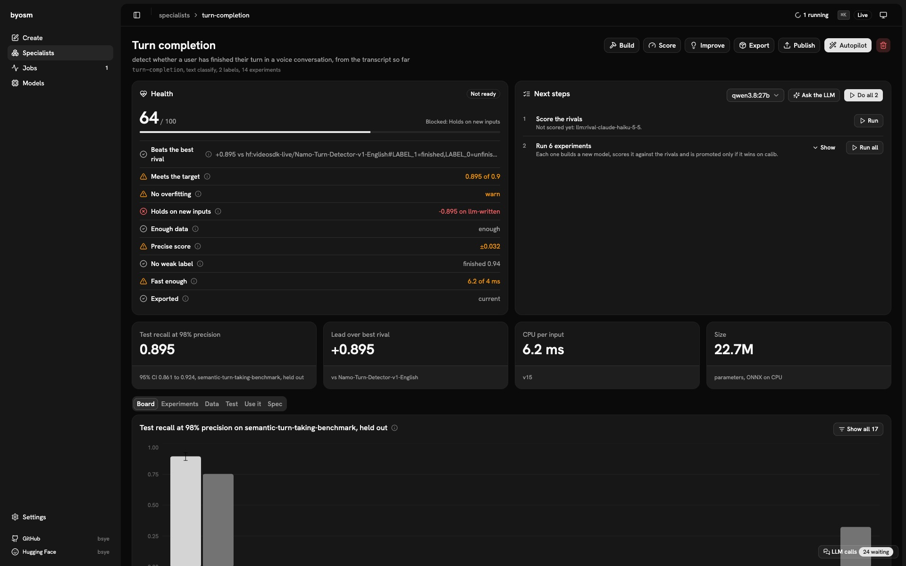
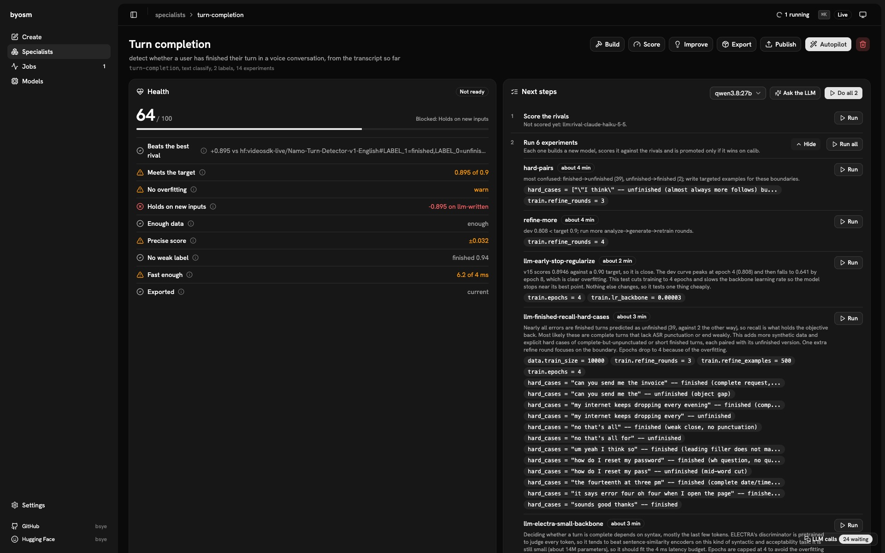
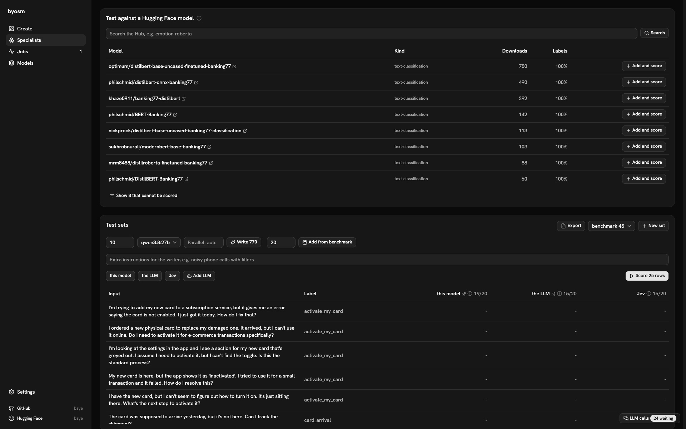
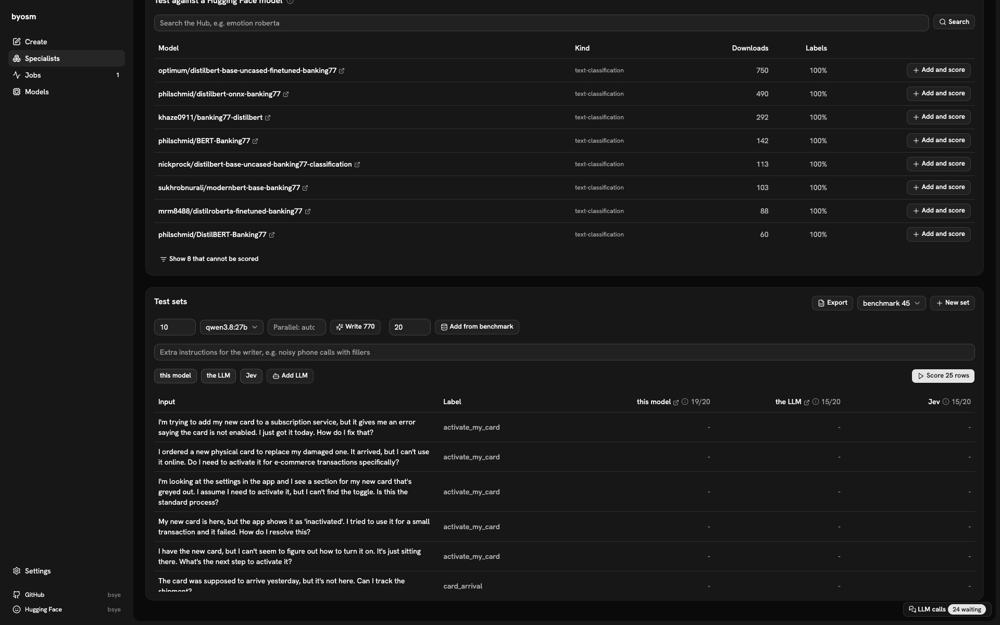
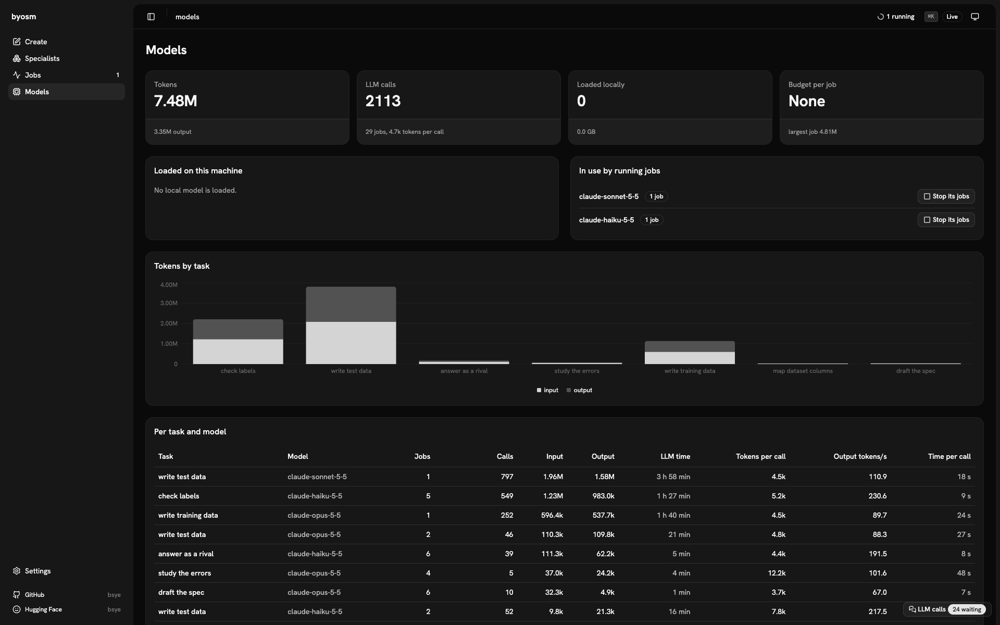

<p align="center"><b>Tour</b> · <a href="docs/assumptions.md">Goal and bet</a> · <a href="docs/methodology.md">Methodology</a> · <a href="docs/results.md">Results</a> · <a href="docs/details.md">Details</a></p>

<h1 align="center">BYOSM</h1>

<p align="center"><b>Build Your Own Specialist Model.</b><br>One sentence in, a small model out that beats the big ones at its job, on a public benchmark, on any CPU.</p>

<p align="center">
  <a href="LICENSE"></a>
  <a href="https://huggingface.co/bsye"></a>
  
  
</p>

<p align="center"></p>
<p align="center"><sub>Every specialist, its lead over the best rival, and the jobs running now.</sub></p>

## Run it

```bash
git clone https://github.com/bsye/BYOSM && cd BYOSM
python3.11 -m venv .venv && .venv/bin/pip install -e '.[dev,silero]'
.venv/bin/byosm app                     # opens http://127.0.0.1:8765 with its token
```

It brings its own LLM picker: local Ollama or LM Studio, Claude Code, Codex, or an API key.

## Tour

### Describe the task


One sentence and the LLM you have; the autopilot does the rest.

### Check its health



A health score with every check behind it, and the next steps to fix what fails.

### Pick the next experiment



Health and next steps: proposed experiments, each with why and the spec changes it makes.

### See it against its rivals


Test and calib scores with 95% intervals for every model and rival, scored by the same code.

### Test it against Hugging Face



Hub models for the same task, ready to add and score as rivals.

### Test it on new inputs



Named test sets written by an LLM or taken from the benchmark, with each model's score.

### Watch it build


Every job live: its stage, its progress and its log.

### Act while the user types


A team of specialists fires the action before the sentence ends, with no LLM at runtime.

### Know what the LLM costs



Tokens and calls per task, and which LLM each running job uses.

Models on Hugging Face: [bsye](https://huggingface.co/bsye) ·
[byosm-doctype](https://huggingface.co/bsye/byosm-doctype) ·
[byosm-intent](https://huggingface.co/bsye/byosm-intent) ·
[byosm-vad](https://huggingface.co/bsye/byosm-vad)

<p align="center"><b>Tour</b> · <a href="docs/assumptions.md">Goal and bet</a> · <a href="docs/methodology.md">Methodology</a> · <a href="docs/results.md">Results</a> · <a href="docs/details.md">Details</a></p>
