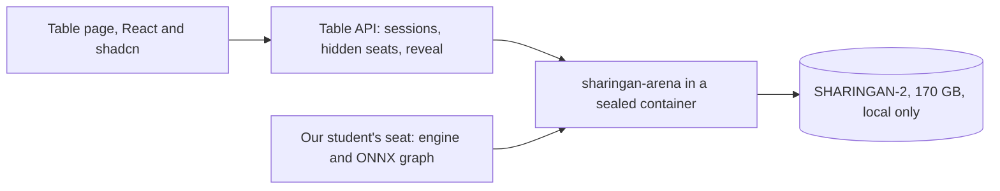

# Poker arena: watch, play and measure the bot

Goal: a six-seat poker table on the owner's domain where the bot BYOSM trained sits with other bots, the owner can
simulate hands or take a seat, every seat's result is measured, and only at the end the table says which seat was
which bot. It is a baseline to look at before any money is spent on a bigger teacher. Play money only.

## Decisions so far (2026-11-24)

| Question | Decision |
|---|---|
| Where it lives | A separate project for the site; BYOSM only exports the bot for it |
| Opponents | An open-source poker bot, next to the bot we trained |
| Who can open it | Behind Cloudflare Access at first: the student stays private |
| Order | Now, as the baseline before the rented-machine step of [the Pluribus push](GAMES.md) |
| Budget | $300 for the rented machine, spent only after this baseline |

## Open-source opponents found

| Bot | Licence | What it is | Fit |
|---|---|---|---|
| [SHARINGAN](https://github.com/markokraemer/poker-sharingan): [SHARINGAN-1](https://huggingface.co/markokraemer/sharingan-1) and [SHARINGAN-2](https://huggingface.co/markokraemer/sharingan-2) | Apache-2.0, code and weights | A Pluribus reproduction: six seats, 100 big blinds, lossless cards before the flop and 200 buckets after. Checkpoints: B-local 28.3 GB, SHARINGAN-1 124.7 GB, SHARINGAN-2 169.9 GB. Ships a self-hosted arena (duplicate deals, six simple house bots) where an outside bot plays over stdin and stdout | The strongest opponent we can get. Too big to host: a Cloudflare container has at most 20 GB of disk. One month old, numbers are the author's own |
| [G5](https://github.com/Nemandza82/g5-poker-bot) | MIT | Winner of the six-player no-limit event of the 2018 Annual Computer Poker Competition, by its own README. It models each opponent and searches the game tree; no equilibrium strategy. C++ and .NET 8, builds on Linux (it has a Dockerfile), ships its six-player opponent statistics (84.6 MB), speaks the competition's protocol and has a Python interface | The hosted open-source opponent: small enough for a container, and it adapts to who it plays, the opposite style to ours |
| Always-call, random, a tight and a loose rule bot | ours | Simple fixed players | Trivial to host; our bot already wins about 2,900 mbb/hand against callers, so they show the table works, not how strong the bot is |

## SHARINGAN-2 changes the rented-machine step

| | Our teacher | SHARINGAN-2, by its model card |
|---|---|---|
| Training | 1 billion iterations (running) | 183 billion, the budget of the Pluribus paper, on 64 cores and 576 GB |
| Cards after the flop | 12 buckets | 200 buckets |
| Situations stored | about 160 million | 14.5 billion |
| Size | 12 GB | 169.9 GB |
| Against simple bots | +3,410 ±190 mbb/hand against five callers | +2,572 ±118 against a calling station, +4,004 ±197 against random, +125 ±35 against a tight bot |
| Against people | not tested | not tested |

The rented machine was meant to train a 50 and then a 200-bucket teacher. That teacher is already published, at a
length $300 would not reach, under a licence that lets us use it. So:

1. **Test before training.** Seat our teacher and our student against it in its own arena. If we are close, more
   training buys little; if we lose clearly, we know by how much.
2. **It can be the teacher.** If it wins clearly, the student is distilled from it instead of from ours, and the
   product is the same: a model of a few megabytes that plays like a 170 GB table.
3. **The money moves from compute to disk.** This Mac has 70 GiB free. The 28.3 GB checkpoint (a smaller bet menu,
   described as the light option for normal machines) fits today; the 169.9 GB one needs a freed or external disk,
   or a rented machine with a large disk for a day or two, which costs far less than a week of 64 cores.

What is not known: its numbers are self-reported by a project that is one month old; its README says both models have
known exploitable weaknesses around bet sizes off its menu; nobody has tested it against strong players. Before its
score counts, our run of one of its published numbers must reproduce it. Open for the distilling: 14.5 billion
situations cannot be listed the way our 98 million were, so the student would learn from sampled play, and it must
read 200 buckets or the cards themselves.

## Status (2026-11-24)

| Piece | State |
|---|---|
| Room for the 169.9 GB file | Done: the owner approved clearing Docker's build cache, three stopped Rust build volumes and 76 merged worktrees; 69 to 223 GiB free |
| `byosm poker blueprint-fetch` | Done: 169.9 GB, every part and the joined file match the published SHA-256 |
| SHARINGAN's code in a sealed container | Built from commit `6a11d9b4` on this Mac (ARM); its bench tool runs with no network |
| Our student at its table | Built: `seat.py` answers the bench tool's requests with the student as a 5.64 MB ONNX graph; 3,618 decisions in a 1,800-hand trial, none failed |
| `byosm poker arena-gauntlet NAME` | Run for our student and for SHARINGAN-2 (tables below) |
| `byosm poker arena-versus HERO FIELD` | Run both ways between our student and SHARINGAN-2 (table below) |
| Hosted table | Not started |

## Result: SHARINGAN-2 is far stronger than our v1 (2026-11-24)

SHARINGAN's bench tool, 20,000 deals each played from every seat (120,000 hands), AIVAT, mbb/hand with a 95%
interval ([all results](results.md)). Every decision of our seat was answered.

| One seat | The other five | Result |
|---|---|---|
| Our v1 student | SHARINGAN-2 | -555.5 ±62.1 |
| SHARINGAN-2 | our v1 student | +480.4 ±53.6 |

| The other five seats | Our v1 student | SHARINGAN-2 here | SHARINGAN-2 as published | Reproduced |
|---|---|---|---|---|
| tight | -674.0 ±64.8 | +125.4 ±35.1 | +125 ±35 | yes |
| tight-aggressive | -944.9 ±94.9 | +339.9 ±56.0 | +303 ±56 | yes |
| loose-aggressive | -1,375.1 ±131.7 | +1,024.3 ±86.3 | +933 ±85 | yes |
| maniac | -1,756.9 ±141.6 | +982.3 ±104.7 | +1,622 ±99 | no, lower here |
| calling station | +6,905.5 ±411.6 | +9,039.7 ±290.1 | +2,572 ±118 | no, higher here |
| random | +3,262.0 ±243.4 | +3,878.3 ±190.6 | +4,004 ±197 | yes |

What it says:

- **Our own teacher is not worth more compute.** It was only ever measured against itself, callers and random
  players. Against anything that folds and bets for value it loses, and the student copies it. More rounds of the
  same 12-bucket teacher, here or on a rented machine, would not close a gap of this size.
- **SHARINGAN-2 is the teacher to use.** It beats all six simple bots and beats our bot by about half a big blind a
  hand from either side of the table. Its licence (Apache-2.0) allows it.
- **Its published scores hold for four of six bots.** The two that differ were run here on the repository's latest
  commit, which is four days newer than the model card; the cause is not established. Nobody has measured it
  against strong players, and its own README names bet sizes off its menu as a weakness.

The next build is therefore a small student of SHARINGAN-2, measured at this same table, and the table itself.

## The table: reuse SHARINGAN's table server, build only the page and the seats

SHARINGAN ships a table server (`sharingan-arena`, Apache-2.0,
[its API](https://github.com/markokraemer/poker-sharingan/blob/main/docs/TABLE_API.md)): six seats, the rules,
seeded deals, a WebSocket seat protocol with the legal moves in chips, its blueprint and six simple bots as house
players, matches of a planned number of hands, standings, and every hand's history. We do not write a rules engine.

| Step | Where | What |
|---|---|---|
| 1 | This Mac | The table server sealed on an internal Docker network, reachable only from this machine; SHARINGAN-2, its simple bots and our student seated; the page to simulate hands, to play a seat, to see every seat's result and to reveal who was who |
| 2 | Cloudflare | The same page and API as a Worker with a Durable Object per session and the table server in a Cloudflare Container. SHARINGAN-2 cannot go there (a container has at most 20 GB of disk), so the hosted seats are the simple bots, our student, and later a student of SHARINGAN-2 |

The table is its own project beside this one (TypeScript, the platform's language on Workers). BYOSM keeps the
measuring commands and exports the student's seat.

## Hosted table: acceptance

| # | Story | Done when |
|---|---|---|
| 1 | Simulate | GIVEN a new table of six bots WHEN the owner asks for the next 100 hands THEN the hands play out, each seat's stack and winnings update, and no seat's identity is shown |
| 2 | Play along | GIVEN the owner takes a seat WHEN it is his turn THEN he sees his cards and the legal moves with their amounts, and the bots act in turn around him |
| 3 | Measure | GIVEN any number of hands THEN every seat shows hands played and mbb/hand with a 95% interval, and the page says when the interval is too wide to tell seats apart |
| 4 | Batch | GIVEN a request for 100,000 hands THEN they run without the animation and the same table of results comes back |
| 5 | Reveal | GIVEN the owner ends the session THEN the table names each seat's bot and the session is stored with its results |
| 6 | Private | GIVEN any request from the browser THEN no model weights, no hidden cards and no seat identities are in the response before the reveal |

## Edge cases

| Case | Handling |
|---|---|
| 100 hands | Shown as watching, not measuring: the interval is printed next to every number |
| The owner leaves mid-hand | His seat folds when its clock runs out; the session can be resumed |
| A bot errors or times out | The seat checks or folds, the event is logged, the session continues |
| All-in with side pots | Settled by the engine, the same code that scores our table tests |
| The container is asleep | The page says it is waking the bots; the first hand waits for it |
| Unequal stacks after a hand | Stacks reset to 100 big blinds every hand, the format every bot here was trained for |

## What BYOSM still owes the table

- The student's seat for the table server's live protocol (`your_turn` in, a move in chips out), reusing `seat.py`.
- `byosm poker export`: the student's graph, its encoding, its card abstraction and the engine binary as one bundle.
- A student distilled from SHARINGAN-2.

## Cost

Workers Paid is $5 a month and includes 25 GiB-hours of container memory and 375 vCPU-minutes; beyond that a
container costs $0.0000025 per GiB-second of memory and $0.000020 per vCPU-second, and it sleeps when idle
([pricing](https://developers.cloudflare.com/containers/platform/pricing/)). A 1 GiB student container awake for an
hour is under one cent of memory.

## Not in scope

Real money, public sign-up, hosting a 28 GB or larger opponent on Cloudflare, mobile apps.

## Needs the owner

1. The deploy itself: the owner runs the `wrangler` commands; nothing is deployed from here.
2. G5 as a further hosted opponent: yes or no to building it from its GitHub repository.
3. Whether his own seat counts in a session's results when he plays along.
