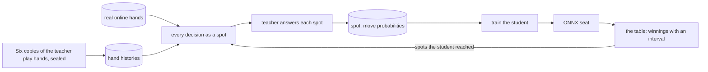

# A small student of SHARINGAN-2

Goal: a model of a few megabytes that plays six-seat hold'em like the 170 GB blueprint, judged at the same table.
This is the BYOSM claim for poker: the specialist is small, runs without the big file, and its strength is measured.
Nothing here is built; it is the plan to agree on. Results so far and the table are in [ARENA.md](ARENA.md).

## What exists

| Piece | State |
|---|---|
| The teacher | SHARINGAN-2, verified on disk; its inference server answers any hand with a probability for every move |
| Labelling speed | 91,356 decisions answered in a 27 second job; 10 million decisions is under an hour |
| A table to judge at | `arena-versus` and `arena-gauntlet`, 120,000 hands in two to four minutes |
| A seat for a small model | `seat.py`: an ONNX graph answers the table in chips |
| The v1 student | Reads our weak engine's 12 card buckets and move tokens; it copies a teacher that loses, so it is not reused |

## How it works

| Step | What | Why this way |
|---|---|---|
| 1. Spots | Hands played by six copies of the teacher in its own table server, sealed; later the spots the student itself reaches, and spots from the 21.6 million real hands | A student must be right where it will stand, not only where the teacher stands |
| 2. Labels | The teacher's probability for each legal move at each spot, raise sizes kept as shares of the pot | The full distribution teaches more than one sampled move |
| 3. What the student reads | The cards themselves, the seats, the stacks and every bet so far as a share of the pot | No 200-bucket tables (280 MB) and no engine of ours at play time; the bundle stays small |
| 4. What it answers | A probability for fold, check or call, and a fixed menu of raise sizes as shares of the pot, all in included | One menu the seat turns into chips |
| 5. Judged | At the table against five teachers and against each rule bot; on the logged decisions; by size and by time per move | Agreement alone hid v1's weakness; winnings did not |

## Done when

| # | Given | When | Then |
|---|---|---|---|
| 1 | a workspace with the teacher on disk | `byosm poker student-rows --hands N` | N self-played hands become rows (spot, teacher probabilities), the count and the time are printed, rerunning adds nothing new |
| 2 | rows | `byosm poker student` | a student is trained; held-out agreement with the teacher's top move and the divergence are reported |
| 3 | a student | `arena-versus STUDENT sharingan-2` and the reverse | winnings with a 95% interval; the low end is above -100 mbb/hand from both sides |
| 4 | a student | `arena-gauntlet STUDENT` | its interval is above zero against each of the four rule-based bots |
| 5 | a student | `student-decisions` | within 3 points of the teacher's 88.2% with Pluribus and 85.2% with the professionals |
| 6 | a student | export | under 50 MB, under 5 ms a move on this Mac, and it sits at the poker table as a live seat |
| 7 | any of 3 to 5 failing | Health | a failing check whose next step is the command that fixes or measures it |

## Edge cases

| Case | Handling |
|---|---|
| The teacher falls back (a line it never trained on) | The row is kept out of training and counted; the share is reported |
| A bet size off the student's menu | Mapped to the nearest size by share of the pot; the mapping lives in one place used by training and by the seat |
| Stacks that are not 100 big blinds | The teacher was trained at 100; rows are generated at 100 and the student is labelled as such |
| Fewer than six players | Out of scope for the first student |
| Equal agreement, worse winnings | Winnings decide; that is criterion 3 |
| Rows from real hands show only showdown players | Used as extra spots, never as the only source |

## What is not known

- How small a model can hold a 14.5 billion situation strategy. The first run answers it: 1 million hands, one model
  size, criteria 2 to 5. Then the size and the number of hands are varied, one at a time.
- Whether reading raw cards is enough, or the student needs computed hand strength as an input. Computed inputs are
  code, not learned, if they are needed.
- A student that imitates well can still be easy to exploit. The table against rule bots and the teacher is the only
  check we have for that today.

## Cost and order

| Phase | Work | Time on this Mac |
|---|---|---|
| 1 | Rows: sealed self-play, spots, labels, stored once by content | half a day to build, under two hours to run for 1 million hands |
| 2 | Encoder, student, training, held-out report | a day |
| 3 | Seat, the three table measures, health checks | half a day |
| 4 | Reach rounds, real-hand spots, size sweep | open |

SHARINGAN-2 is Apache-2.0: a student of it may be kept private or shared, with its notice. It stays off real poker
sites.
